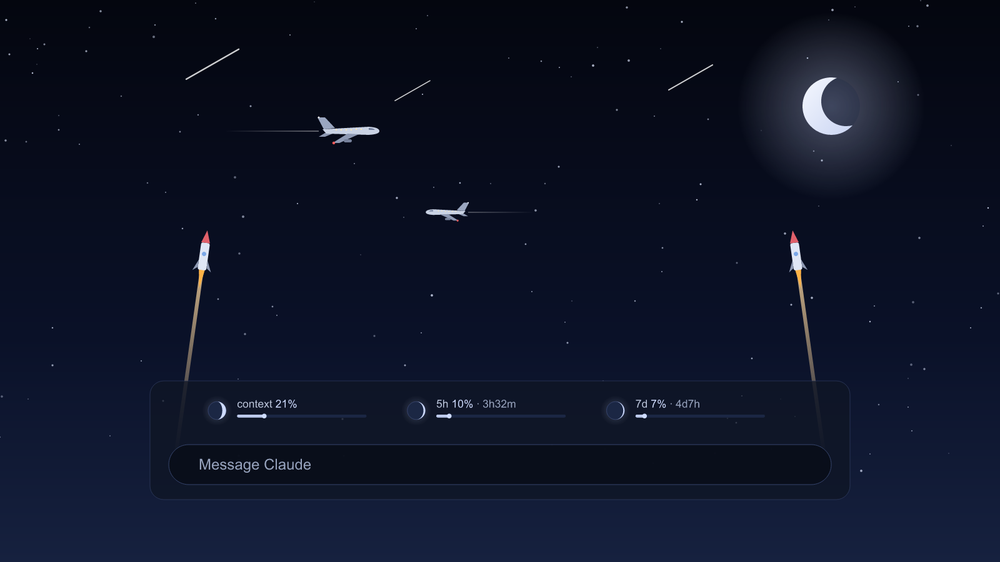
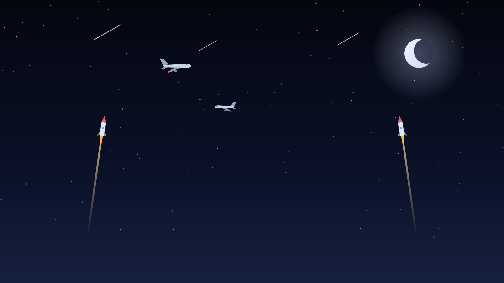
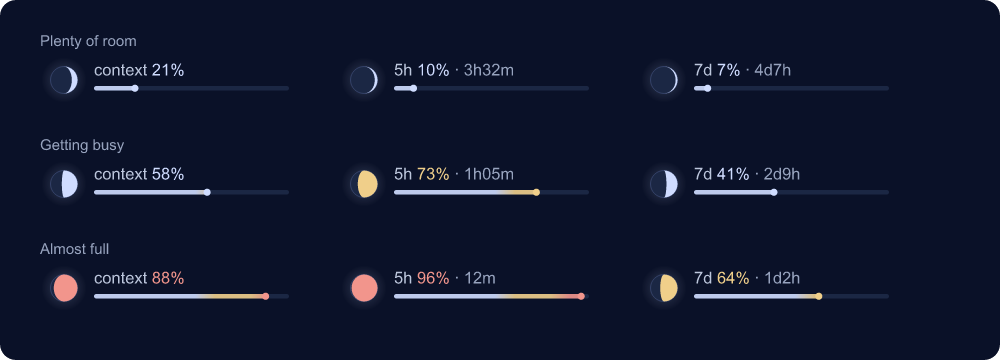

<div align="center">

# 🌙 night-sky

**A slow, dark night sky for the Claude desktop app, with a moon-phase meter for your context and rate limits.**

[](LICENSE)




<sub>A preview rendered from the mod's own artwork, frozen at one moment. In the app everything moves slowly.</sub>

</div>

## What it does

night-sky is a mod for Claude. It has two parts, and you get both when you install it.

**1. A night-sky background (desktop app)**

- About 140 stars that twinkle slowly, and a glowing crescent moon.
- Planes cross the sky, rockets launch from the left and right, and shooting stars streak past, every so often.
- Surfaces and text are tinted deep blue to match. The look is dark only.
- If you have reduced motion turned on, the sky is drawn still, with no planes or rockets.



**2. A moon-phase meter band (desktop app and terminal)**

A slim band above the message box shows how full your context window and your rate limits are. Each meter has a moon that fills from new to full as usage goes up, a thin bar with a glowing star at the end, and the time until the limit resets.



- The bar changes color along its length: blue first, amber from about 60%, red from about 85%.
- Context shows how full the window is. Each rate limit your account reports gets its own meter, such as the 5-hour and 7-day windows.
- Rate-limit meters only appear on a subscription that reports them. Without one you just see context.

## Install

You need the Claude desktop app, or Claude Code in a terminal. Pick one.

### In the desktop app

1. Click **+** next to the message box.
2. Choose **Plugins**, then **Add marketplace**.
3. Type `celalk-172/night-sky` and confirm.
4. Choose **Add plugin** and pick **night-sky**.
5. Start a new session, or reload plugins, to see it.

### In a terminal

Run this at the prompt of a Claude Code session:

```
/plugin install night-sky --marketplace celalk-172/night-sky
```

Or from your shell:

```bash
claude plugin install night-sky --marketplace celalk-172/night-sky
```

Say `y` if it asks to add the marketplace, then pick a scope. Start a new session, or reload plugins, to see it.

## What you get in each place

| | Desktop app | Terminal |
| --- | --- | --- |
| Night-sky background and colors | ✅ | ❌ (a terminal can't draw them) |
| Moon-phase meter band | ✅ drawn, with bars and a glow | ✅ as one line of text |

In a terminal the band is a single line, with a moon emoji, a colored bar and the percentage for each meter. Context also shows tokens used:

```
🌓 context ━━━━━───── 42% 207k/1000k   🌔 5h ━━━━━━━──── 73% 2h14m
```

## Privacy

The mod only reads the usage numbers your Claude session already has: context fill and rate-limit percentages. It makes no network requests and doesn't read or write any files.

## Customizing

Everything is in [`hooks/register.tsx`](hooks/register.tsx). Common changes:

- **Colors:** the `makeColors` call near the top sets the surface and text colors.
- **How often things appear:** the animation rules in the sky's CSS set how often planes, rockets and shooting stars show up. Smaller numbers mean more often.
- **Meter colors:** `tone` and `termTone` pick the blue, amber and red.

To try your edits, clone this repository and start Claude Code with `claude --plugin-dir /path/to/night-sky`. In a session started that way, saving a file reloads the mod.

## Troubleshooting

- **The sky doesn't show.** The background only draws in the desktop app. Start a new session after installing.
- **No rate-limit meters.** Only accounts that report rate-limit windows get them. Context always shows once Claude has replied.
- **Two bands show.** Another mod or plugin that draws its own limit band can sit beside this one. Remove the one you don't want.
- **Nothing at all in the terminal.** Start a new Claude Code session after installing. Plugins load at session start.

## Repository layout

```
.claude-plugin/plugin.json   plugin manifest
.claude-plugin/marketplace.json   lets people install it from this repository
hooks/register.tsx           the mod: sky, theme and meter band
hooks/make-colors.js         color helper, used as is
types/index.d.ts             the mod's stored values
docs/                        preview images used in this README
```

## License

[MIT](LICENSE). The bundled `hooks/make-colors.js` is a helper for building themes that ships with the mod tooling and is included unchanged.
